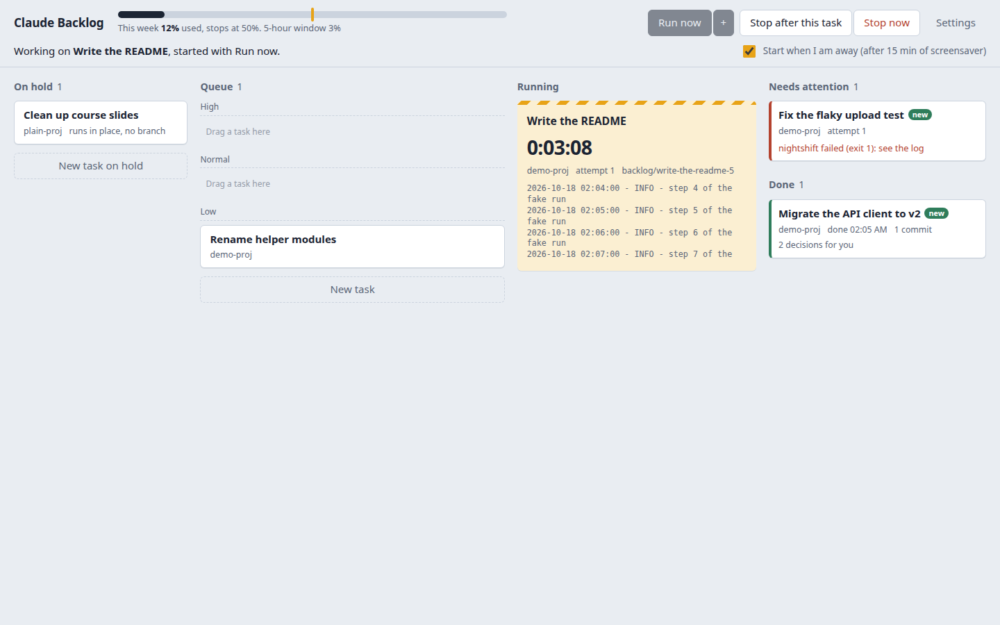
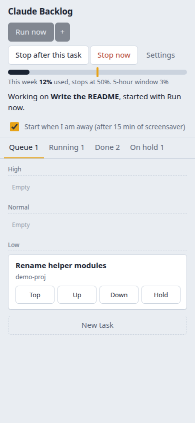

# claude-backlog

A backlog board for Claude Code. Put long tasks that Claude can do on its
own into a queue, each with a prompt and a priority. When you leave, Claude
works through them one by one, each on its own git branch, and stops at the
share of your weekly limit that you choose.



> claude-backlog is an independent open-source tool. It is not made or
> endorsed by Anthropic. It runs Claude Code with your own login and
> subscription.

**Status:** alpha (0.1.0). Linux with systemd.

## What it does

- **A board in the browser**, on your own computer: On hold, Queue (High,
  Normal, Low), Running, Done and Needs attention. Drag a card to change its
  priority; click it to read the prompt, the log, the result and the diff.
- **Runs while you are away.** Press **Run now** before you leave, or just
  walk away: when the screensaver has been on for a while (15 minutes by
  default) the queue starts by itself, and it stops when you come back.
- **Stops at a weekly limit you set** (50% by default), so the rest of the
  week stays yours.
- **One task at a time, each on its own branch.** Every task runs in its own
  git worktree on a branch `backlog/<task>`. Your working copy is never
  touched; you review the result as a diff and merge what you want.
- **Waits out the 5-hour limits** through
  [claude-nightshift](https://github.com/SciScend/claude-nightshift), which
  resumes the task when the window resets.
- **Keeps the computer awake** while the queue runs (`systemd-inhibit`).
- **From your phone too**, through your own Tailscale network: see what is
  running and change what Claude does next.
- **Easy to add tasks:** type `/backlog` in a Claude Code session and Claude
  writes the unattended prompt for the task you were discussing. There is
  also a form on the board and a command line.



## Requirements

- Linux with systemd (user services).
- [Claude Code](https://docs.claude.com/en/docs/claude-code), installed and
  logged in.
- git and Python 3.10 or newer, and [uv](https://docs.astral.sh/uv/) (or
  pipx).
- For phone access: [Tailscale](https://tailscale.com) on the computer and
  the phone.

## Install

```bash
uv tool install git+https://github.com/SciScend/claude-backlog
claude-backlog install
```

`install` sets up a systemd user service that runs the board at
<http://127.0.0.1:8765/>, installs the `/backlog` skill for Claude Code into
`~/.claude/skills/backlog/`, and adds a "Claude Backlog" launcher to your
desktop menu. claude-nightshift is installed with it.

The service keeps running when you log out only if lingering is on
(`loginctl enable-linger`); `install` tells you if it is off.

## Using it

### Add tasks

The prompt is everything the next Claude session will know. Nobody will be
there to answer questions, so write it for someone who cannot ask you
anything: the goal, the files involved, how to check the result, and when
it is done.

- **`/backlog` in Claude Code.** While you work with Claude and see a long
  job coming, type `/backlog` (optionally with a hint). Claude writes a
  self-contained prompt from the conversation and the code, shows it to you,
  and adds it after your OK. If the project has uncommitted changes, it
  lists them and offers to commit them first, with a proposed message.
- **The board.** Press "New task", pick the project folder (type to search
  your projects, or type a path), say in a few sentences of your own what
  Claude should do, choose a priority, and press **Add**. The task is on
  the board at once, marked "drafting", while Claude writes the full prompt
  in the background, usually in 10 to 20 seconds: one call (Sonnet at low
  effort by default; see Settings) with an outline of the project that the
  board gathers itself (the file list, README, CLAUDE.md, the build and
  test commands, and the files that match your description), so the prompt
  has real paths and the project's own test commands. Where your
  description leaves something open, the prompt makes an assumption, and
  the card lists the question with that assumption; answering is optional
  and adds your answer to the prompt. Only when a question blocks the task
  (for example goals that contradict each other) does it wait on hold for
  your answer. You can read and change the prompt on the card. Or press
  "Write it myself" and fill in the prompt template.
  If the project has uncommitted changes, the form says so and offers
  **Commit now**: it lists the changed files and commits them all on the
  current branch with the message you write (your git identity, your
  hooks; files in `.gitignore` stay out).
- **The command line.**

  ```bash
  claude-backlog add -p high "Migrate src/api to the v2 client; run the tests after each module"
  claude-backlog add -C ~/projects/site task.md     # a task file, see below
  echo "..." | claude-backlog add -C ~/projects/site -
  ```

  `add` prints a note when the project has uncommitted changes, and adds
  the task anyway.

A task starts from the last commit, so uncommitted changes in your
checkout are not part of it, and merging its branch later can conflict
with them. Commit them first if the task needs them.

The prompt template asks for what guides on unattended coding agents agree
on: **Goal** (and why), **Context** (where to start, how to run it),
**Constraints** (what must not change), **Done when** (observable results,
each with the command that checks it), **Milestones** for long tasks, and
**When unsure** (which choices Claude may make alone and which to leave for
you). You can change it in Settings; `claude-backlog template` prints it.

claude-backlog adds its own rules to every prompt: work without asking,
keep progress notes in `STATE.md` so the work can be resumed, work in small
checked steps and commit them on the task's branch only, do not weaken
tests to make them pass, and finish with a `SUMMARY.md` that lists the
decisions left for you.

### Order and priority

The queue runs top to bottom: High first, then Normal, then Low. Drag cards
to reorder them or move them between groups, or use "Run next" on a card.
Cards on hold do not run. Within one run every queued task gets a turn
before any task gets a second one.

### Start the queue

- **Run now** on the board (or `claude-backlog go`). The small menu next to
  it starts a run that takes no new task after a given time.
- **When you are away**, if "Start when I am away" is on: when the
  screensaver has been on for the set number of minutes. When you come back,
  a run that started this way stops at once; the task goes back to the queue
  and continues from its notes next time. (Settings can let it finish the
  current task instead.) A run you started with Run now is not stopped when
  you come back.

The queue stops when the weekly limit is reached, when it is empty, or when
you press **Stop after this task** or **Stop now**.

Leave the laptop lid open: closing it suspends the computer even while the
queue runs. The board warns you when the computer would go to sleep before
the away delay is reached.

### The weekly limit

"Stop when weekly usage reaches" (Settings, or click the marker on the usage
bar) is passed to claude-nightshift for every task. No new Claude session
starts once your weekly usage is at or above it. A task can have its own
limit.

Each attempt at a task may use two 5-hour windows by default. A task that is
not finished goes back to its place in the queue and is tried again, up to
three attempts, after which it needs your attention.

### Results

Finished tasks appear under **Done**, marked "new" until you open them. The
task panel shows Claude's `SUMMARY.md`, the commits and the diff of its
branch, every attempt with its log, and the command to merge the branch:

```bash
git -C ~/projects/site merge backlog/migrate-the-api-client-to-v2-1
```

Archiving a task removes its worktree and keeps the branch. Every run also
writes a report (`claude-backlog report`) and shows a desktop notification
when the queue stops.

A folder that is not a git repository works too: the task then runs in the
folder itself, without a branch.

### Several tasks on the same project

Each task's branch starts from the base branch as it is when the task
starts, so two tasks on the same project do not see each other's work
unless you merged the first one in between. That keeps every branch
independent: you can merge or drop each one on its own.

- When a task builds on another one, set **Start from** to "after" that
  task (or `add --after ID`). It waits in the queue until the other task is
  done, then starts from that task's branch, so merging it brings in both.
- The board checks every finished, unmerged branch against its base branch
  and against the other finished branches of the same repository (with
  `git merge-tree`, which touches no files; git 2.38 or later). A card that
  would conflict says so, and the task panel lists the files.

### From your phone

1. Install Tailscale on the computer and the phone, logged in to the same
   account, and start it (`tailscale up`).
2. Run `claude-backlog install --phone`. It runs
   `tailscale serve --bg --https=443 http://127.0.0.1:8766` once; this
   persists across reboots.
3. On the board, open Settings, enter your Tailscale login, and scan the QR
   code with the phone. Add the page to the home screen.

On the phone the columns become tabs, and each card has Top, Up, Down and
Hold buttons.

## Safety

Claude runs unattended with `--dangerously-skip-permissions`: nobody is
there to approve its actions, so it can run any command as you. Keep that in
mind when you write tasks.

- Each task works in a separate git worktree on its own branch. Claude is
  told not to push, merge or touch anything outside the worktree and its
  task folder, and the branch is only merged when you do it.
- When Claude writes a task's prompt on the board, it gets no tools and
  no MCP servers (`--tools ""`, `--strict-mcp-config`): it only reads the
  outline of the project that the board puts in the request.
- The board listens on `127.0.0.1` only and refuses requests from other web
  pages, because anyone who can use it can make Claude run commands.
- Phone access goes through `tailscale serve` to your own devices, and only
  the Tailscale login set in Settings gets in. Never expose the board with
  Tailscale Funnel or an open port.

## Commands

```
claude-backlog install [--phone]     install the service, the /backlog skill and a launcher
claude-backlog uninstall             remove them (your tasks stay)
claude-backlog open                  open the board in the browser
claude-backlog add [-C DIR] [-p high|normal|low] [-t TITLE] [--hold] [--after ID] PROMPT | FILE | -
claude-backlog list [-a]             the queue, what runs, what needs attention
claude-backlog go [--until HH:MM]    start the queue now
claude-backlog stop [--now]          stop after the current task, or now
claude-backlog export ID             print a task as a task file
claude-backlog report                print the latest run report
claude-backlog template              print the prompt template
claude-backlog serve [--port N]      run the service in the foreground
```

### Task files

A task can also be written as a Markdown file with front matter:

```markdown
---
title: Migrate the API client to v2
project: ~/projects/acme-app
priority: high
model: opus
effort: high
max-windows: 3
---
Migrate every call in src/api/ from the v1 client to the v2 client. ...
```

Optional fields: `status: hold`, `threshold`, `max-attempts`,
`base-branch`, `after` (the id of a task to start after). Without
`project`, `add` uses the git root of the file's folder.

## Where things are

- Data: `~/.local/share/claude-backlog/` (or `$CLAUDE_BACKLOG_HOME`): the
  database, each task's folder (`tasks/<id>/` with the prompt, `STATE.md`,
  `SUMMARY.md` and logs), the worktrees and the reports.
- Service: `~/.config/systemd/user/claude-backlog.service`; logs with
  `journalctl --user -u claude-backlog`.
- `$CLAUDE_BACKLOG_NIGHTSHIFT` overrides how claude-nightshift is run.

## How it fits with claude-nightshift

claude-nightshift runs **one** task across 5-hour windows within a weekly
budget, and says through its exit code why it stopped. claude-backlog owns
everything around it: the queue, the board, starting and stopping, worktrees
and reports. It never decides anything from usage figures itself.

The design is in [docs/design.md](docs/design.md).

## Development

```bash
git clone https://github.com/SciScend/claude-backlog
cd claude-backlog
uv sync --extra dev
uv run pytest
uv run ruff check src tests
uv run claude-backlog serve --port 18765    # try it without installing
```

The tests need neither Claude nor a desktop: a fake nightshift script plays
each exit code. See [CONTRIBUTING.md](CONTRIBUTING.md).

## License

MIT, see [LICENSE](LICENSE).
